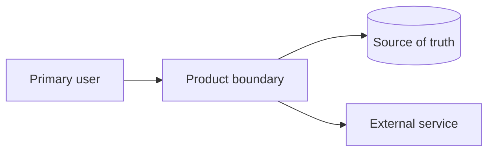
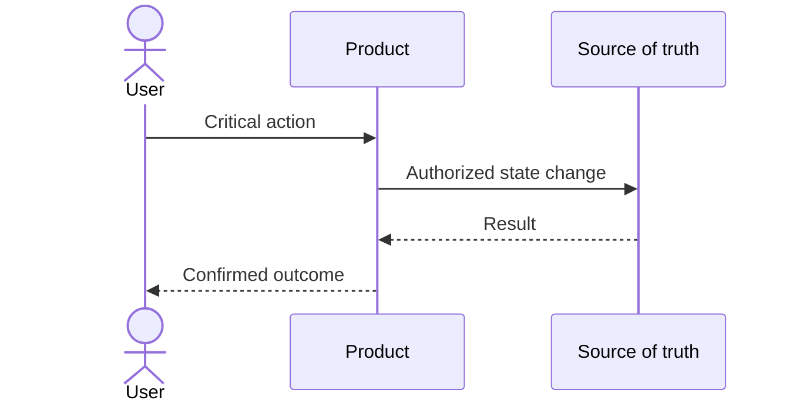

# Product System Blueprint — [Product]

Status: Draft / Awaiting confirmation / Ready with assumptions / Ready
Last updated: [date]

## Executive design summary

[Product-specific design, current stage, governing constraints, and why this is the minimum sufficient architecture.]

## Users, actors, and critical journeys

| Actor | Goal | Critical journey | Success | Failure consequence |
|---|---|---|---|---|
| | | | | |

## System boundary

[What this product owns, what users/partners own, and what external providers own.]

## Workload and data estimates

| Measure | Launch range | Growth range | Inputs/evidence | Confidence |
|---|---:|---:|---|---|
| Daily active users | | | | |
| Peak requests/second | | | | |
| Stored data | | | | |
| Monthly growth | | | | |

## Quality constraints

| Journey/capability | Latency | Availability/failure tolerance | Recovery/data loss | Security/compliance |
|---|---|---|---|---|
| | | | | |

## Domain and data ownership

| Entity | Owner/source of truth | Key relationships | Sensitive? | Lifecycle/retention | Consistency rule |
|---|---|---|---|---|---|
| | | | | | |

## Identity, authorization, and trust boundaries

[Authentication, tenant/resource permissions, administrative powers, secrets, audit, privacy, and deletion.]

## Critical-journey sequence

## Component decision ledger

| Component/capability | Status | Product need and evidence | Smallest useful form | Trade-off/failure | Verification | Trigger |
|---|---|---|---|---|---|---|
| | Required now | | | | | |
| | Deferred | | | | | |
| | Conditional | | | | | |
| | Excluded | | | | | |

## Interactions and integrations

| Interaction | Sync/async | Contract/source of truth | Timeout/retry/idempotency | Degraded behaviour |
|---|---|---|---|---|
| | | | | |

## Failure, degradation, and recovery

| Scenario | Detection | User experience | Recovery/reconciliation | Owner |
|---|---|---|---|---|
| | | | | |

## Observability and cost controls

[Critical-journey signals, alerts and owners, variable cost drivers, quotas/budgets, retention.]

## Risks, open choices, and scaling triggers

| Risk/choice | Current response | Trigger/evidence required | Related ADR |
|---|---|---|---|
| | | | |

## Verification plan

| Claim | Evidence needed | Method | Pass condition | Phase |
|---|---|---|---|---|
| | | | | |

## Visual artifact register

Follow the bundled Visual Design Contract; do not duplicate its rules here.

| Diagram ID/version | Purpose/level | Source | Governing baseline and decisions | Validation evidence | Approval/freshness |
|---|---|---|---|---|---|
| | | | | | |

Record omitted views and their reasons. Store machine-readable records in diagram-records/*.json beside the design pack. Each record follows the shared contract and is checked by scripts/validate_visual_pack.py. A draft without records may be reviewed but cannot claim visual completion.

## Governing requirements and design traceability

Handoff record: design-handoff.json. Record exact baseline identity/version/hash, approval evidence, freshness and DRAFT/READY state. LLD declares its governing HLD dependency or justified non-applicability. Do not infer approval from this document's readiness label.

| Decision ID | Requirement IDs | Acceptance criterion IDs | Governing HLD version (LLD) | Evidence/limitations |
|---|---|---|---|---|
| | | | | |

Visual coverage: visual-coverage.json records each relevant view as supplied, justified omitted or incomplete.
